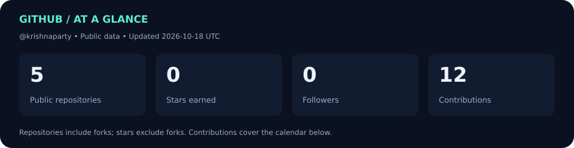
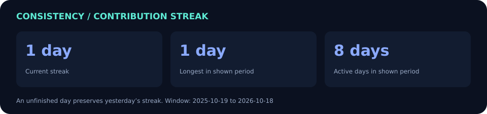
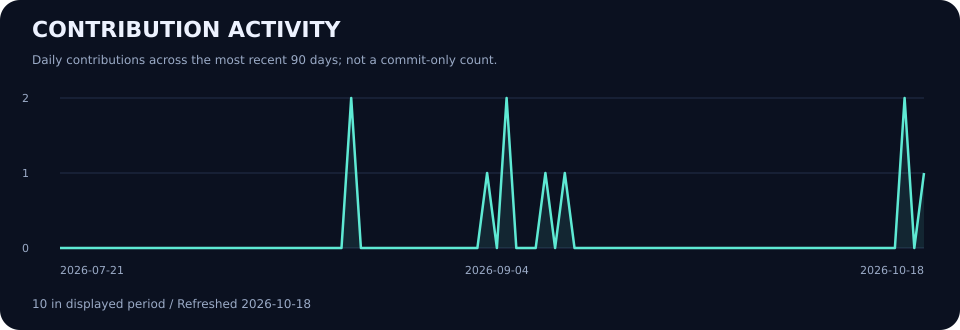
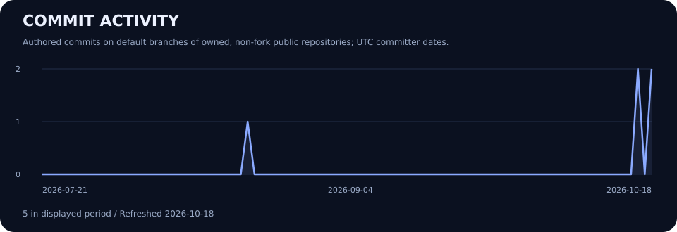

  

  <a href="https://github.com/krishnaparty?tab=repositories"><strong>Projects</strong></a> &nbsp; · &nbsp;
  <a href="#-github-analytics"><strong>Analytics</strong></a> &nbsp; · &nbsp;
  <a href="https://linkedin.com/in/krishangupta030606"><strong>LinkedIn</strong></a> &nbsp; · &nbsp;
  <a href="https://leetcode.com/krishna07gupta"><strong>LeetCode</strong></a> &nbsp; · &nbsp;
  <a href="mailto:krishnagupta030606@gmail.com"><strong>Get in touch</strong></a>

# Hi, I'm Krishna 👋

**Frontend developer exploring cloud engineering and full-stack development.**

I'm a B.Tech CSE student at **GLA University, India**, building applications that connect useful interfaces with cloud services. My current focus is **CloudCampusAI**: bringing AWS resource visibility, governance checks, and cost recommendations into one dashboard.

- 🔭 **Building:** CloudCampusAI with React, FastAPI, and AWS.
- 🌱 **Learning:** AWS, Azure, DevOps, and full-stack development.
- 🤝 **Collaborating on:** cloud dashboards, frontend features, and backend integrations.
- 💬 **Let's talk about:** full-stack development and turning project ideas into working applications.

---

## 🛠️ Technology toolkit

  

| Focus | Technologies |
| :--- | :--- |
| **Frontend** | React · JavaScript · HTML · CSS · Vite |
| **Backend & data** | Python · FastAPI · Boto3 · MySQL |
| **Cloud project services** | Amazon EC2 · CloudWatch · AWS Cost Explorer |
| **Currently learning** | AWS · Azure · DevOps · Full-stack development |

<strong>More languages and tools I explore</strong>

C · Java · Node.js · Flask · Flutter · Docker · Kubernetes · Linux · Google Cloud · MongoDB · PostgreSQL · SQL Server · Figma · Framer

---

## 🚀 Featured work

### ☁️ CloudCampusAI

**One dashboard for understanding an AWS environment.**

CloudCampusAI brings resource inventory, governance checks, and optimization recommendations together, helping an administrator review cloud resources without jumping between service pages.

| Area | What the project does |
| :--- | :--- |
| **Resource visibility** | Lists AWS resources, their states, and ownership information. |
| **Governance** | Flags missing `OwnerEmail`, `Project`, and `Environment` tags. |
| **Optimization** | Recommends reviews of stopped or idle EC2 instances. |
| **Monitoring & forecasting** | Develops CPU anomaly detection and cost forecasts using historical data. |

**Built with:** `React` `Vite` `FastAPI` `Python` `Boto3` `MySQL` `AWS`

**Progress:** Frontend, backend, resource synchronization, governance checks, and optimization recommendations are implemented. Anomaly detection and cost forecasting require sufficient historical data; final testing and deployment verification are in progress.

**[Explore source code →](https://github.com/krishnaparty/cloudpython_project)**

### 📚 Cloud coursework

[Cloud-3rd-year-26-27](https://github.com/krishnaparty/Cloud-3rd-year-26-27) — my fork of the cloud course repository, kept separately from my original project work.

**[Browse all repositories →](https://github.com/krishnaparty?tab=repositories)**

---

## 📊 GitHub analytics

### 🔥 Contribution streak

### 🟩 Contribution calendar

### 📈 Recent contribution activity

### 💻 Commit activity

How these numbers are counted

- **Public repositories** includes forks; private repositories are excluded.
- **Stars earned** sums stars on my owned, non-fork public repositories.
- **Contributions** comes from my public GitHub contribution calendar and includes more than commits.
- **Streaks** use the displayed calendar window. The longest streak is for that window, not an all-time claim. A day still in progress does not break yesterday's streak.
- **Commit activity** counts my authored commits on the default branches of my owned, non-fork public repositories, grouped by UTC committer date. Contributions to other people's repositories, other branches, and private repositories are outside this graph's scope.
- Charts show their last successful refresh date. [Refresh workflow](https://github.com/krishnaparty/krishnaparty/actions/workflows/profile-stats.yml).

---

## 🎯 What I'm working toward

- Build clearer interfaces for complex cloud information.
- Write reliable APIs and improve project documentation.
- Strengthen deployment, monitoring, and automation skills.
- Learn through practical projects and collaboration.

## 🤝 Let's connect

| Platform | Find me |
| :--- | :--- |
| **LinkedIn** | [krishangupta030606](https://linkedin.com/in/krishangupta030606) |
| **LeetCode** | [krishna07gupta](https://leetcode.com/krishna07gupta) |
| **Instagram** | [krishna3.x](https://instagram.com/krishna3.x) |
| **Email** | [krishnagupta030606@gmail.com](mailto:krishnagupta030606@gmail.com) |

Build something useful. Understand how it works. Keep improving.

